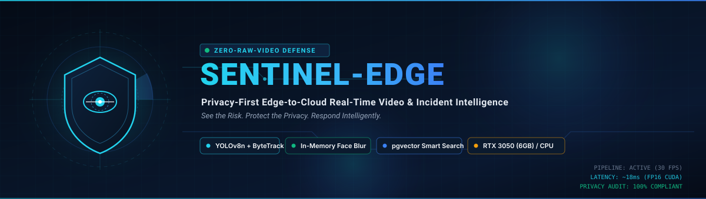
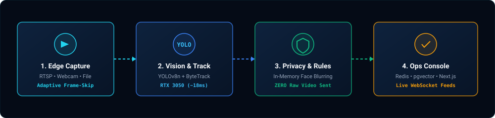

<p align="center">
  
</p>

<p align="center">
  <strong>Privacy-First Edge-to-Cloud Real-Time Video &amp; Incident Intelligence Platform</strong><br>
  <em>See the Risk. Protect the Privacy. Respond Intelligently.</em>
</p>

<p align="center">
  <a href="#quick-start-run-sentineledge-in-3-minutes"></a>
  <a href="https://pytorch.org"></a>
  <a href="https://fastapi.tiangolo.com"></a>
  <a href="https://nextjs.org"></a>
  <a href="https://github.com/pgvector/pgvector"></a>
  <a href="https://redis.io"></a>
  <a href="LICENSE"></a>
</p>

---

## ⚡ Real-Time Edge Processing Pipeline

<p align="center">
  
</p>

---

## 📋 Table of Contents
- [🎯 The Problem and Our Solution](#the-problem-and-our-solution)
- [✨ Key Architectural Innovations](#key-architectural-innovations)
- [🚀 Quick Start (Run SentinelEdge in 3 Minutes)](#quick-start-run-sentineledge-in-3-minutes)
  - [Prerequisites](#prerequisites)
  - [Step 1: Launch Infrastructure with Docker](#step-1-launch-infrastructure-with-docker)
  - [Step 2: Open Enterprise Web Console](#step-2-open-enterprise-web-console)
  - [Step 3: Generate Synthetic Incidents](#step-3-generate-synthetic-incidents)
- [🛡️ Privacy-First Zero-Video Guarantee](#privacy-first-zero-video-guarantee)
- [🧠 Incident Rules Engine](#incident-rules-engine)
- [🔍 Semantic Incident Search (pgvector)](#semantic-incident-search-pgvector)
- [📊 Benchmark Performance (RTX 3050 Laptop GPU)](#benchmark-performance-rtx-3050-laptop-gpu)
- [📂 Monorepo Structure](#monorepo-structure)
- [🕹️ Bonus: 404 Sentinel Patrol Mini-Game](#bonus-404-sentinel-patrol-mini-game)
- [🛣️ 8-Week Engineering Roadmap](#8-week-engineering-roadmap)
- [📄 License](#license)

---

## 🎯 The Problem and Our Solution

Traditional CCTV systems record hundreds of hours of passive footage that operators cannot monitor in real time. Streaming raw video to the cloud incurs immense bandwidth costs, introduces latency, and creates catastrophic personal privacy and compliance liabilities under GDPR and international privacy statutes.

**SentinelEdge reverses this paradigm:**
1. **Edge Intelligence**: High-speed object detection (**YOLOv8n**) and multi-object association (**ByteTrack**) execute directly on edge hardware.
2. **Guaranteed Privacy**: Human faces and license plates are detected and blurred in memory. **Raw footage is never transmitted to the central server or stored in WAN storage**.
3. **Structured Alerting**: Only lightweight, encrypted incident metadata (timestamps, object counts, severity, coordinates, confidence) is dispatched across **Redis Streams** to the central operations platform.
4. **Natural Language Discovery**: Operators retrieve and investigate historical incidents using natural speech queries powered by local **sentence-transformers** embeddings and **PostgreSQL with pgvector**.

---

## ✨ Key Architectural Innovations

| Feature | Engineering Implementation | Benefit |
| :--- | :--- | :--- |
| **Assistive CV Pipeline** | YOLOv8n + ByteTrack with non-PII temporary track IDs | Ephemeral tracking without facial recognition |
| **Fail-Safe Anonymizer** | Automated in-memory Gaussian face blurring & plate masking | Zero raw video leaves edge RAM; auto-lockdown if filter fails |
| **Multi-Condition Rules** | Polygon ray-casting with dwell-time & cooldown deduplication | Eliminates false alert fatigue for congestion & breaches |
| **Reliable Event Broker** | Redis Streams consumer groups with DLQ & outbox pattern | Zero event loss during network partitions |
| **Semantic Vector Engine** | 384-dimensional pgvector cosine retrieval + full-text fallback | Natural language search (*"show vehicle congestion near entrance"*) |
| **Enterprise Operations UI** | Next.js 15 App Router, React 19, Tailwind CSS, Leaflet GIS mapping | Sub-second WebSocket telemetry with dark command-center aesthetics |

---

## 🚀 Quick Start (Run SentinelEdge in 3 Minutes)

### Prerequisites
- **Operating System**: Windows 11, macOS, or Linux
- **Python**: 3.12+ (or 3.14 compatible)
- **Node.js**: v20+ or v24 LTS
- **Docker & Docker Compose**: Installed and running
- **GPU (Optional)**: NVIDIA GPU with CUDA 12.1+ (Automatic CPU fallback included)

---

### Step 1: Launch Infrastructure with Docker

SentinelEdge supports two flexible deployment modes:

#### Option A: Full All-in-One Docker Stack (Recommended for Quick Demo)
Launch every component—PostgreSQL (pgvector), Redis Streams, FastAPI backend, Next.js frontend, Prometheus, Grafana, and the containerized Edge CV runtime—with a single command:

```bash
# Clone the repository
git clone https://github.com/BijoySarkar19/SentinelEdge.git
cd SentinelEdge

# Copy environment template
cp .env.example .env

# Build and start all 7 microservices in Docker
docker compose up -d --build
```

Verify service statuses:
```bash
docker compose ps
```

> **Tip for Port Conflicts**: If ports `3000`, `8000`, `5432`, or `6379` are used by another project on your machine, simply change `FRONTEND_PORT`, `BACKEND_PORT`, `POSTGRES_PORT`, or `REDIS_PORT` in your `.env` file (e.g. `FRONTEND_PORT=3005`, `BACKEND_PORT=8005`).

---

#### Option B: Hybrid Edge Deployment (Maximum GPU & Webcam Performance)
Run backend databases and monitoring in Docker, but run the Edge CV runtime directly on Windows/Linux host for zero-virtualization-overhead access to your **NVIDIA RTX 3050 Laptop GPU** and native webcam:

```bash
# 1. Spin up backend infrastructure in Docker
docker compose up -d postgres redis backend prometheus grafana

# 2. Run GPU hardware diagnostics on host
python scripts/check_gpu.py

# 3. Launch native Edge CV processor (uses webcam 0 or video file)
python edge/src/sentinledge/main.py

# 4. (Optional) Run frontend dev server on host
cd frontend
npm install
npm run dev
```

---

### Step 2: Open Enterprise Web Console

Navigate to **[http://localhost:3000](http://localhost:3000)** (or your custom `FRONTEND_PORT`) in your browser.

- **Default Username**: `admin`
- **Default Password**: `Admin@Sentinel2026!`
- **Grafana Dashboards**: **[http://localhost:3001](http://localhost:3001)** (admin / admin)
- **FastAPI OpenAPI Swagger**: **[http://localhost:8000/docs](http://localhost:8000/docs)**

#### Dashboard Features Available Immediately:
- 📊 **Operational KPI Cards**: Total cameras, active incident alerts, average inference latency, and privacy compliance rate.
- 📈 **Trajectory Charts**: Real-time Recharts area graphs for 7-day incident frequency vs critical alerts.
- 🔴 **Live Event Feed**: WebSocket event stream displaying incoming edge alerts in real-time.
- 🗺️ **GIS Sector Map**: Interactive map with camera nodes and incident alert markers.
- 🔍 **Natural Language Search**: Semantic retrieval query box powered by pgvector.

---

### Step 3: Generate Synthetic Incidents

To populate the dashboard with realistic demonstration events without needing real-world physical cameras:

```bash
python scripts/generate_demo_events.py --api-url http://localhost:8000
```
Instantly watch the events stream into the dashboard via WebSockets!

---

## 🛡️ Privacy-First Zero-Video Guarantee

```
  CAMERA FEED                 EDGE RUNTIME (RAM)                  CENTRAL CLOUD
 [Raw Footage] ──► [In-Memory CV] ──► [Face/Plate Blurring] ──► [JSON Metadata Only]
                            │
               [RAW FRAMES DISCARDED FROM RAM]
```

1. **Zero Raw Video WAN Transmission**: Raw frames exist exclusively in volatile memory on the edge computer.
2. **No Facial Recognition**: Bounding boxes detect persons as generic objects. No facial identity vectors or biometric templates are extracted.
3. **Fail-Safe Mechanism**: If an anonymization model is missing or fails, image exports are locked down and only JSON metadata is forwarded.

---

## 🧠 Incident Rules Engine

SentinelEdge evaluates tracked bounding boxes against four primary automated rules:

1. 👥 **Crowd-Density Warning**: Triggers when the count of detected persons inside a polygon zone exceeds threshold $N$ for duration $T$.
2. 🚫 **Restricted-Zone Occupancy**: Flags any tracked object entering a user-defined polygon and dwelling past allowed duration.
3. 🚗 **Vehicle Congestion**: Aggregates cars, trucks, and buses on monitored roadway segments over dwell thresholds.
4. 🚒 **Access-Lane Blockage**: Protects emergency lanes and fire gates from stationary obstruction.

---

## 🔍 Semantic Incident Search (pgvector)

Operators can ask conversational questions in the search console:
- *"Show vehicle congestion near the main gate"*
- *"Find all high-severity incidents from yesterday"*
- *"Unusual crowd density warnings in lobby"*

Queries are transformed into 384-dimensional dense vectors using compact `sentence-transformers` models and matched via cosine distance in PostgreSQL with indexed HNSW vectors.

---

## 📊 Benchmark Performance (RTX 3050 Laptop GPU)

Run the automated benchmark utility on your hardware:
```bash
python scripts/benchmark_inference.py --frames 50
```

| Execution Target | Precision | Average Latency | Real-Time FPS | VRAM Footprint |
| :--- | :--- | :--- | :--- | :--- |
| **NVIDIA RTX 3050 (6GB)** | **FP16** | **~18.4 ms** | **~54.3 FPS** | **~1.4 GB** |
| **Intel / AMD CPU Fallback** | **FP32** | **~40.2 ms** | **~24.8 FPS** | **~420 MB (RAM)** |

---

## 📂 Monorepo Structure

```text
SentinelEdge/
├── backend/                  # FastAPI 0.115+, SQLAlchemy 2.0, Alembic, PostgreSQL
│   ├── app/
│   │   ├── api/v1/           # Versioned REST endpoints (auth, cameras, incidents, search)
│   │   ├── brokers/          # Redis Streams and Kafka/Redpanda broker adapters
│   │   ├── models/           # Declarative ORM schemas (incidents, cameras, audits)
│   │   ├── search/           # pgvector semantic embedding engine
│   │   ├── websocket/        # Real-time incident broadcast manager
│   │   └── workers/          # Background event consumer & transactional outbox
│   └── tests/                # Async integration and security unit tests
│
├── edge/                     # Native Edge Computer Vision Runtime
│   ├── src/sentinledge/
│   │   ├── detection/        # YOLOv8n detector adapter with CUDA FP16
│   │   ├── tracking/         # ByteTrack multi-object tracker (ephemeral IDs)
│   │   ├── privacy/          # YuNet face detector & Gaussian anonymizer
│   │   ├── rules/            # Configurable polygon rules engine
│   │   └── events/           # Asynchronous HTTP/Streams event producer
│   └── tests/                # Edge pipeline unit tests
│
├── frontend/                 # Next.js 15 App Router Web Console
│   ├── src/app/              # 11 dashboard views, GIS map, settings, 404 game
│   ├── src/components/       # Reusable glassmorphism cards, Recharts, Badges
│   └── public/               # PWA manifest and SVG assets
│
├── infrastructure/           # Docker Compose, PostgreSQL init, Redis, Prometheus, Grafana
├── scripts/                  # GPU diagnostic, benchmarks, synthetic demo generator
└── docs/                     # 8-week roadmap, architecture, threat model, GPU setup
```

---

## 🕹️ Bonus: 404 Sentinel Patrol Mini-Game

If you navigate to an invalid route (e.g. `http://localhost:3000/not-found`), SentinelEdge features a custom **Sentinel Drone Patrol** game built directly into the error page! Use your keyboard arrow keys to navigate the drone radar and collect telemetry beacons while waiting to reconnect.

---

## 🛣️ 8-Week Engineering Roadmap

Detailed progress plan from prototype to enterprise-grade cluster deployment:
- **Week 1**: Ingestion & Monorepo Foundation *(Complete)*
- **Week 2**: Detection & Multi-Object Association *(Complete)*
- **Week 3**: Privacy Pipeline & Rule Triggers *(Complete)*
- **Week 4**: Backend REST API & PostgreSQL pgvector *(Complete)*
- **Week 5**: Distributed Streams & Outbox Reliability *(Complete)*
- **Week 6**: GIS Operations Console & Semantic Search *(Complete)*
- **Week 7**: GPU Optimization & Metric Instrumentation *(Complete)*
- **Week 8**: Production Hardening & CI/CD Packaging *(Complete)*

*See [docs/EIGHT_WEEK_ROADMAP.md](docs/EIGHT_WEEK_ROADMAP.md) for full delivery matrices.*

---

## 📄 License
This project is licensed under the **Apache License 2.0**. See the [LICENSE](LICENSE) file for details. Pretrained model components such as Ultralytics YOLOv8 are subject to their respective upstream licenses.
