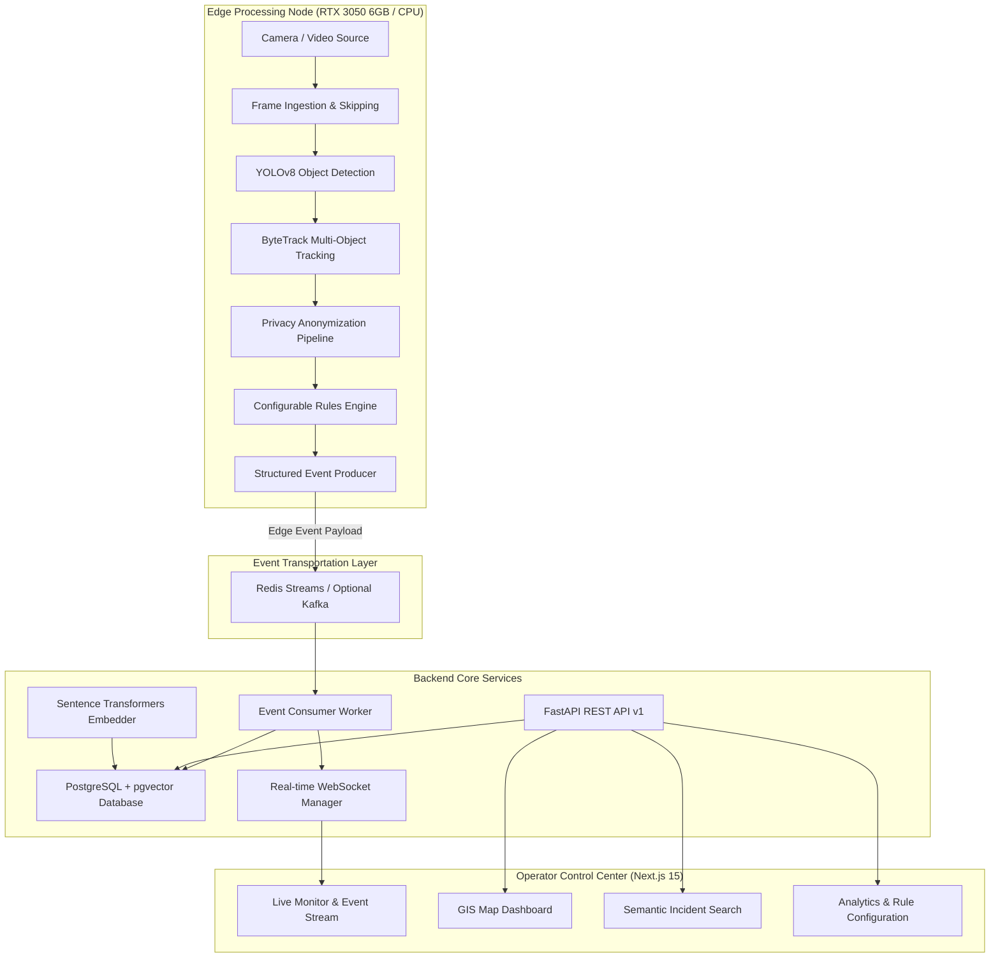

# SentinelEdge Technical Architecture

## 1. High-Level System Architecture

## 2. Edge-to-Cloud Privacy Boundary
SentinelEdge maintains a strict data boundary:
- Video frames NEVER leave the local edge device.
- All object bounding boxes, tracking associations, and face anonymization occur in local memory.
- Central ingestion endpoints accept only structured JSON incident metadata.
